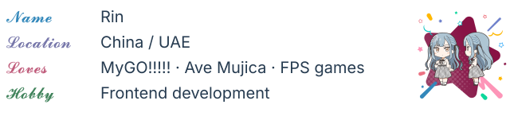
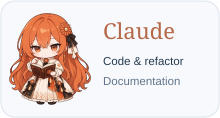

<h1 align="center"></h1>

  

<h3 align="center"></h3>

  

<h3 align="center"></h3>

  
  
  
  
  
  
   
  
  
  
  
  
  

<h3 align="center"></h3>

AI-assisted development

  
  

<h3 align="center"></h3>

  

