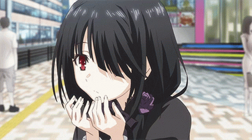
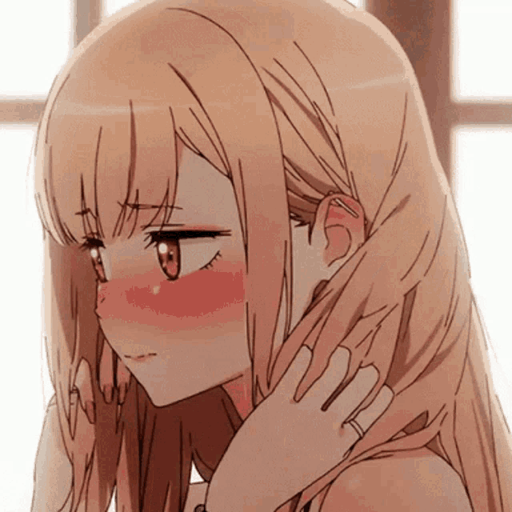
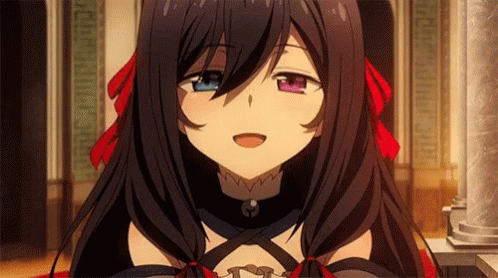

<h1 align="center">💖 Hi, I'm Rin</h1>

Frontend development · Anime · FPS games

  

## 🌸 About me

- **Name:** Rin
- **Location:** China / UAE
- **Interests:** Anime and FPS games
- **Hobby:** Frontend development

 

## 🛠️ Tech stack

**Languages**

  
  
  
  
  
  
  

**UI & frameworks**

  
  
  
  
  
  

**Backend & tools**

  
  
  
  
  
  

## 📝 Find me

[X / Twitter · @KurumiRin](https://twitter.com/KurumiRin)

---

<strong>💖 Thanks for stopping by!</strong>

  

